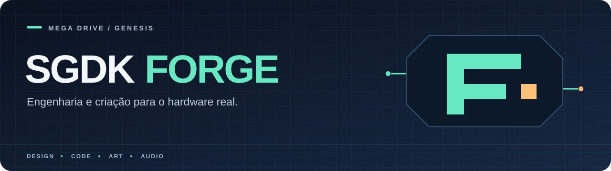
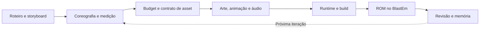

<p align="center">
  
</p>

<p align="center">
  <strong>Da ideia à ROM. Com domínio do hardware e evidência de cada avanço.</strong>
</p>

<p align="center">
  <a href="https://github.com/Stephane-D/SGDK/releases/tag/v2.11"></a>
  
  
  <a href="LICENSE"></a>
</p>

<p align="center">
  <a href="#comece-aqui">Comece aqui</a> ·
  <a href="#o-que-você-encontra">Explore</a> ·
  <a href="#produção-com-evidência">Workflow</a> ·
  <a href="#hardware-como-parte-do-design">Hardware</a> ·
  <a href="#contribua">Contribua</a>
</p>

---

O **SGDK Forge** reúne ferramentas, projetos e um framework de agentes para criar jogos de Mega Drive / Genesis com **SGDK 2.11**. Código, arte, animação, áudio e design compartilham o mesmo processo: planejar, medir, integrar e observar a ROM.

O hardware real é o alvo. A validação em emulador tem evidência própria; compatibilidade física, qualidade de gameplay e desempenho precisam ser confirmados por projeto e por versão.

> **“Se não foi visto rodando no emulador, não existe.”**
>
> Build, gameplay, áudio e performance são aceites separados. A meta de 60 FPS exige medição da cena pesada; não é um selo geral deste repositório.

## O que você encontra

| Área | O que oferece | Explore |
| :--- | :--- | :--- |
| **Produção de jogos** | Projetos com código, recursos, design e memória operacional próprios. | [Projetos](SGDK_projects/README.md) |
| **Build e validação** | Wrapper central para compilar, validar recursos e operar o ciclo de ROM. | [Wrapper SGDK](tools/sgdk_wrapper/README.md) |
| **Agentes especializados** | Skills, workflows e contratos para arte, runtime, hardware, áudio e revisão. | [Framework `.agent`](tools/sgdk_wrapper/.agent/ARCHITECTURE.md) |
| **MUGEN → Mega Drive** | Conversão offline e runtime dedicado em desenvolvimento, com compatibilidade e custo avaliados por recurso. | [Mugen2SGDK Forge](tools/mugen2sgdk_forge) |
| **Engines e referências** | Bases técnicas e estudos para orientar decisões de implementação. | [Engines](SGDK_Engines/README.md) |
| **Direção e conhecimento** | Ciclo de arte, contratos de produção e matriz de técnicas do hardware. | [Documentação](doc/README.md) |

O conversor MUGEN e os jogos têm evolução própria. A presença de uma técnica, skill ou referência não significa que todos os consumidores já a implementem ou tenham sido qualificados.

## Comece aqui

**1. Entenda o workspace.** Leia [AGENTS.md](AGENTS.md), a [estrutura](doc/WORKSPACE_STRUCTURE.md) e o [guia do wrapper](tools/sgdk_wrapper/README.md). O SDK e os emuladores são dependências preparadas separadamente; o clone não inclui o ambiente completo nem todos os insumos dos projetos.

**2. Verifique o ambiente.** Com as dependências configuradas, execute na raiz do checkout, em PowerShell no Windows:

```powershell
powershell -NoProfile -ExecutionPolicy Bypass -File tools/sgdk_wrapper/assert_agent_environment.ps1
powershell -NoProfile -ExecutionPolicy Bypass -File tools/sgdk_wrapper/preflight_host.ps1
```

**3. Escolha um projeto ou crie um pelo wrapper.** Consulte o [catálogo de projetos](SGDK_projects/README.md). Para iniciar outro projeto, use o nome completo previsto na [convenção](doc/PADRAO_NOMENCLATURA.md):

```powershell
.\tools\sgdk_wrapper\new_project.bat "MEU_JOGO [VER.001] [SGDK 211] [GEN] [GAME] [ACTION_PLATFORMER]"
```

**4. Siga o contexto do jogo.** Leia a memória, o GDD, o TDD e os budgets antes de editar. Build e execução passam pelo wrapper compartilhado.

<details>
<summary><strong>Linux e continuidade entre hosts</strong></summary>

A proposta de instalação portátil e continuidade está na [PR #26](https://github.com/Misael-art/genesis-forge/pull/26). Consulte o estado da PR e seus limites antes de usá-la. Não presuma que ferramentas de uma branch de desenvolvimento já estejam disponíveis na `main`.

Pacotes privados de recuperação, assets e evidências locais são transportados separadamente. Não devem ser enviados ao repositório público para completar uma instalação.

</details>

## Produção com evidência

A direção começa com posições, tempo, comportamento e limites mensuráveis. O contrato de asset vem depois dessa decisão.



**Cada área produz uma prova útil:** procedência dos assets, conformidade de pixels e paletas, pressão de sprites, uploads DMA e comportamento observado. A revisão associa a evidência à versão exata da ROM.

| Eixo de entrega | Evidência esperada |
| :--- | :--- |
| **Build** | Compilação concluída e binário identificado. |
| **Validação** | Relatórios e contratos aplicáveis aprovados. |
| **Emulação** | Boot observado no BlastEm, com evidência rastreável. |
| **Gameplay** | Fluxo básico e controles exercitados. |
| **Performance** | Medição da carga representativa, incluindo os piores frames. |
| **Áudio** | Reprodução e integração verificadas; atividade digital sozinha não comprova qualidade sonora. |
| **Continuidade** | Memória operacional atualizada com resultado, limites e próximo passo. |

<details>
<summary><strong>Como ler os estados de um projeto</strong></summary>

| Estado | Significado |
| :--- | :--- |
| `documentado` | Existe em documentos. |
| `implementado` | Existe em código, sem comprovação de build. |
| `buildado` | Compila; execução ainda não comprovada. |
| `testado_em_emulador` | Rodou com evidência vinculada ao binário. |
| `validado_budget` | O orçamento indicado foi confirmado. |
| `placeholder` / `parcial` | Material provisório ou escopo incompleto. |

Esses estados descrevem eixos diferentes; um não aprova automaticamente os demais. Os gates completos estão em [AGENTS.md](AGENTS.md).

</details>

## Hardware como parte do design

| Recurso | Decisão de produção |
| :--- | :--- |
| **Tiles de 8 × 8** | Compor arte e animação no grid nativo, com reaproveitamento consciente. |
| **Paletas e transparência** | Planejar cores por função, legibilidade entre planos e índice transparente. |
| **BG_A, BG_B e WINDOW** | Distribuir profundidade, cenário e interface dentro dos recursos do VDP. |
| **Sprites por scanline** | Medir quantidade e largura: em H40, até 20 sprites e 320 pixels por linha. |
| **VRAM e DMA** | Planejar residência de tiles e uploads no VBlank, incluindo as trocas de animação. |
| **68000** | Usar tipos explícitos, aritmética fixa e buffers estáticos nos caminhos de runtime. |
| **FM, PSG e PCM** | Reservar canais e medir a cena pesada com áudio ativo. |

O objetivo é explorar o teto do hardware preservando leitura, resposta e coerência. Novas otimizações precisam comparar a mesma carga e conservar as funções do jogo.

Veja a [matriz de técnicas](doc/05_technical/93_16bit_hardware_mastery_matrix.md) e o [ciclo de produção artística](doc/03_art/20_canonical_art_production_lifecycle.md).

## Mapa do workspace

```text
SGDK_projects/          Jogos, demos e estudos com contexto próprio
SGDK_Engines/           Engines e referências técnicas
tools/sgdk_wrapper/    Build, validação, templates e framework .agent
tools/mugen2sgdk_forge/ Conversor offline e runtime MUGEN dedicado
tools/emuladores/      Ferramentas de emulação e diagnóstico
sdk/sgdk-2.11/         SDK do workspace, preparado separadamente
doc/                   Documentação, decisões e conhecimento compartilhado
```

Dentro de cada projeto, `src/`, `res/` e `data/` organizam código e insumos; `doc/` mantém contexto; `out/` recebe builds e evidências; `rascunho/` guarda alternativas e entradas de pesquisa.

Na árvore local, quando disponíveis, `doc/project_catalog.json`, `doc/ARCHIVE_MANIFEST_INDEX.md` e `doc/OUTPUT_RETENTION_POLICY.md` complementam a navegação, a consulta histórica e a retenção de outputs.

## Contribua

Abra uma [issue](https://github.com/Misael-art/genesis-forge/issues) com o problema, o resultado esperado e uma forma de reproduzir. Para contribuir com código, siga [AGENTS.md](AGENTS.md), trabalhe no owner existente e informe os checks executados e seus limites no pull request.

Mudanças em runtime ou assets exigem os gates correspondentes. Mudanças documentais precisam de referências válidas e coerência com o estado publicado. Evite incluir ROMs, SDKs, credenciais, pacotes privados ou assets sem autorização de distribuição.

---

<p align="center">
  <strong>Planejar com intenção. Criar no grid. Medir no alvo.</strong><br />
  <sub>SGDK Forge · Mega Drive / Genesis · <a href="LICENSE">MIT</a> para o código coberto pela licença do repositório.<br />
  Componentes e assets de terceiros mantêm seus próprios termos. Projeto independente, sem afiliação à SEGA ou à Elecbyte.</sub>
</p>
